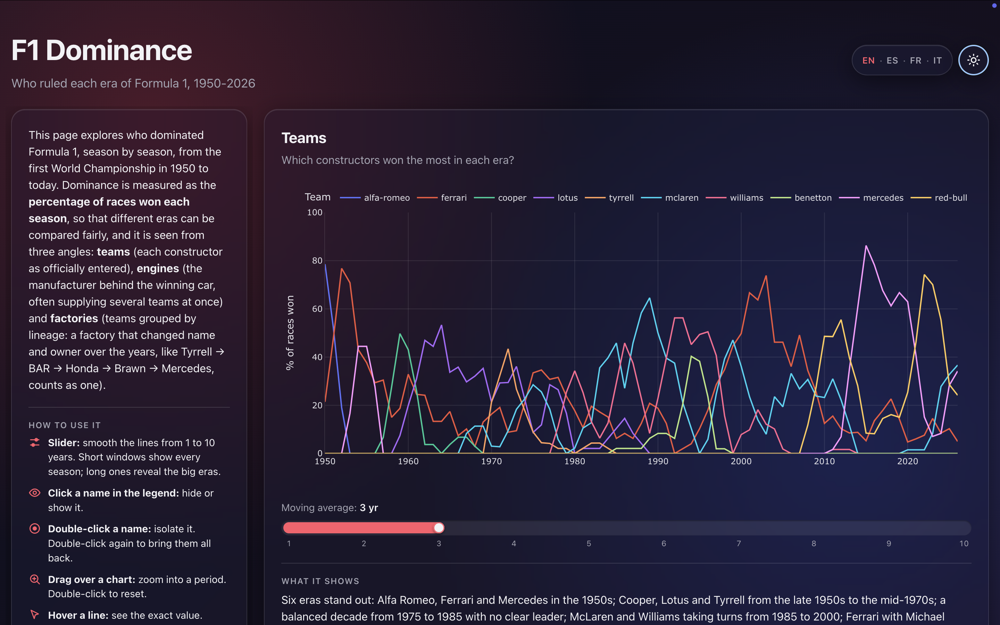

# F1 Analytics

A hands-on learning project in data analytics, big data and AI, using Formula 1 as the common thread. Each case answers a real question with real data.

## Case 1 — Which teams dominated each era of F1?

**[▶ Open the interactive dashboard](https://alir-lab.github.io/f1-analytics/)** · **[Read the full report](https://alir-lab.github.io/f1-analytics/report.html)**

Dominance measured as the **percentage of races won each season** (1950-2026), from three angles: teams, engines and factories. Interactive charts with an animated moving-average slider, light and dark themes, and four languages (English, Spanish, French and Italian).

### Key findings

- **Dominance comes in waves**: six eras, and every one of them has ended. Ferrari is the only team with eras of dominance in very different periods.
- **Mercedes 2014-2016** is the most dominant team spell: 86.3% of races won on a 3-year average.
- **The highest peak of all belongs to an engine**: the Ford Cosworth, with 87.8% in 1973 and 16 seasons at 40% or more.
- **The badge hides part of the story**: grouping teams by factory joins Tyrrell and Mercedes, two eras about 40 years apart.

## What's in this repo

| Path | Content |
|---|---|
| `notebooks/01_dominant_teams.ipynb` | The full analysis: cleaning, metric, charts, challenges and conclusions |
| `dashboard/` | HTML templates of the dashboard and the report |
| `docs/` | The generated website, published with GitHub Pages |
| `figures/` | Static charts |

## Tech stack

- **Python 3.13**, managed with [uv](https://docs.astral.sh/uv/)
- **pandas** for data analysis
- **matplotlib** for static charts and **Plotly** for interactive ones
- **JupyterLab** for exploration
- HTML, CSS and JavaScript for the website, built with the help of Claude Code

## Reproduce the analysis

1. Clone the repo and install the environment: `uv sync`
2. Download `f1db-csv.zip` from the [F1DB releases](https://github.com/f1db/f1db/releases) (v2026.20.0) and unzip it into `data/raw/f1db/`
3. Run the notebook from top to bottom: `uv run jupyter lab`. It regenerates the charts and the website in `docs/`.

## Data

Data from [F1DB](https://github.com/f1db/f1db), licensed under [CC BY 4.0](https://creativecommons.org/licenses/by/4.0/), up to the 2026 Brazilian Grand Prix. Raw data is not included in this repository.

## Status

✅ Case 1 complete. Next: Case 2, finding the best driver once you remove the effect of the car.