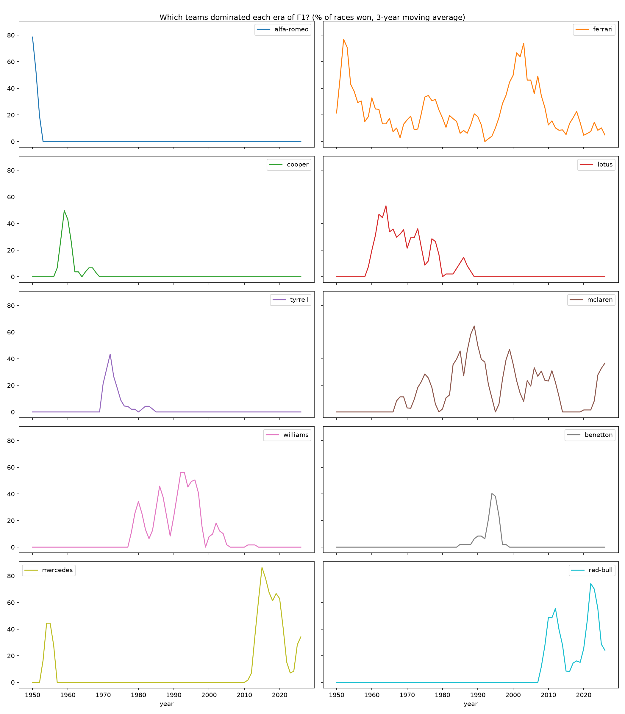

# F1 Analytics

A hands-on learning project in data analytics, big data and AI, using Formula 1 as the common thread. Each stage of the project answers a real question with real data, going from simple analysis on my laptop to automated pipelines, machine learning and real-time telemetry.

## Questions I want to answer

- Which teams dominated each era of Formula 1?
- Who is the best driver once you remove the effect of the car?
- Where exactly does a driver gain or lose time on a lap?
- Can we predict tyre degradation and race strategy?
- How does the weather affect performance?

## Tech stack

- **Python 3.13**, managed with [uv](https://docs.astral.sh/uv/)
- **pandas** and **DuckDB** for data analysis
- **matplotlib** for charts
- **JupyterLab** for exploration

## Case 1 — Which teams dominated each era of F1?

Measured as the percentage of races won by each team per season (3-year moving average), from 1950 to 2026. Mercedes 2014-2016 had the highest share of race wins in F1 history, and Ferrari is the only team with eras of dominance in very different periods.

Full analysis, conclusions and decisions: [notebooks/01_dominant_teams.ipynb](notebooks/01_dominant_teams.ipynb)

## Data

Data from [F1DB](https://github.com/f1db/f1db), licensed under [CC BY 4.0](https://creativecommons.org/licenses/by/4.0/). Raw data is not included in this repository: to reproduce the analysis, download `f1db-csv.zip` from the [F1DB releases](https://github.com/f1db/f1db/releases) and unzip it into `data/raw/f1db/`.

## Status

✅ Case 1 complete: dominant teams by era. Next: Case 2, finding the best driver once you remove the effect of the car.